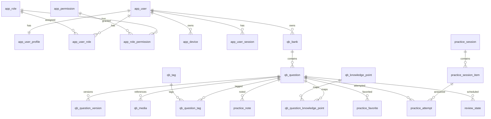

# 博学（Boxue）数据库设计

> 状态：第一版设计草案  
> 数据库：PostgreSQL 16+  
> 关联文档：[project-charter.md](project-charter.md)、[api-contract.md](api-contract.md)

---

## 1. 设计目标

数据库需要同时支撑：

- 开放注册与多用户
- 用户、角色、权限管理（RBAC）
- 题库、题目、版本
- 单选、多选、判断、填空
- 图片与 LaTeX 公式
- 练习、作答、错题、笔记、收藏
- 间隔重复复习
- 三端增量同步
- 导入/导出任务
- 管理后台与审计
- AI 能力预留

设计重点：

1. 用户数据隔离
2. 题目内容与学习状态分离
3. 作答记录可追溯
4. 同步可增量、可重试、可恢复
5. 后续可扩展到课程、主观题、编程题和多用户分享

---

## 2. 设计原则

### 2.1 主键

- 业务表使用 `UUID v7`（应用侧生成，按时间大致有序）
- 同步序号、审计日志使用 `bigserial`
- 不使用自增整数作为业务主键，避免跨端生成和合并困难

### 2.2 时间

- 所有时间使用 `timestamptz`
- 统一以 UTC 存储
- 展示时按用户时区转换
- `created_at`、`updated_at` 默认 `now()`

### 2.3 软删除

业务数据优先使用 `deleted_at` 软删除：

- 题库
- 题目
- 笔记
- 收藏
- 媒体

同步需要墓碑记录，不能直接物理删除后让其他设备无感知。

### 2.4 乐观锁

可编辑实体增加 `version integer not null default 1`：

- 题库
- 题目
- 笔记
- 练习会话

更新时检查版本，冲突返回 `409`。

### 2.5 用户隔离

所有用户数据表带 `owner_id`：

- `owner_id` 外键指向 `app_user(id)`
- 所有查询必须带 `owner_id`
- 管理后台跨用户查询必须经过权限校验和审计

### 2.6 内容与学习状态分离

- 内容：`qb_*`
- 学习状态：`practice_*`、`review_state`
- 作答历史：`practice_attempt` 追加写入

这样题目修改不会破坏历史统计。

### 2.7 枚举策略

第一版使用 `varchar + CHECK`，不使用 PostgreSQL ENUM 类型。

原因：

- ENUM 增加值需要额外迁移
- `varchar + CHECK` 更容易演进
- 应用层仍使用 Java Enum 映射

---

## 3. 扩展与命名

建议启用：

```sql
CREATE EXTENSION IF NOT EXISTS citext;
CREATE EXTENSION IF NOT EXISTS pg_trgm;
```

- `citext`：邮箱、用户名大小写不敏感
- `pg_trgm`：题目模糊搜索

中文全文搜索后续可选：

- `pg_jieba`
- `zhparser`
- Meilisearch

命名规范：

- 表名：`snake_case`，按领域前缀
- 字段名：`snake_case`
- 主键：`id`
- 外键：`xxx_id`
- 时间：`xxx_at`
- 布尔：`is_xxx` 或 `xxx_enabled`
- 索引：`idx_表名_字段`
- 唯一索引：`uk_表名_字段`

领域前缀：

| 前缀 | 含义 |
| --- | --- |
| `app_` | 账号、权限、系统 |
| `qb_` | 题库内容 |
| `practice_` | 练习与学习记录 |
| `review_` | 复习 |
| `sync_` | 同步 |
| `import_` | 导入 |
| `ai_` | AI 预留 |

---

## 4. ER 图



---

## 5. 表清单

### 5.1 账号与权限

| 表 | 用途 |
| --- | --- |
| `app_user` | 用户账号 |
| `app_user_profile` | 用户资料 |
| `app_role` | 角色 |
| `app_permission` | 权限 |
| `app_role_permission` | 角色权限关联 |
| `app_user_role` | 用户角色关联 |
| `app_user_session` | 登录会话 |
| `app_device` | 设备与同步游标 |
| `app_email_verification` | 邮箱验证 |
| `app_password_reset` | 密码重置 |
| `app_user_setting` | 用户设置 |
| `app_audit_log` | 审计日志 |
| `app_announcement` | 公告 |
| `app_feature_flag` | 功能开关 |

### 5.2 题库内容

| 表 | 用途 |
| --- | --- |
| `qb_bank` | 题库 |
| `qb_question` | 题目当前版本 |
| `qb_question_version` | 题目历史版本 |
| `qb_tag` | 标签 |
| `qb_question_tag` | 题目标签关联 |
| `qb_knowledge_point` | 知识点 |
| `qb_question_knowledge_point` | 题目知识点关联 |
| `qb_media` | 图片/媒体元数据 |

### 5.3 练习与复习

| 表 | 用途 |
| --- | --- |
| `practice_session` | 练习会话 |
| `practice_session_item` | 练习中的题目顺序 |
| `practice_attempt` | 作答记录 |
| `practice_note` | 题目笔记 |
| `practice_favorite` | 收藏 |
| `review_state` | 复习状态 |

### 5.4 同步与导入

| 表 | 用途 |
| --- | --- |
| `sync_change` | 同步变更日志 |
| `sync_idempotency` | 同步幂等记录 |
| `import_batch` | 导入批次 |
| `import_item` | 导入明细 |

### 5.5 AI 预留

| 表 | 用途 |
| --- | --- |
| `ai_job` | AI 任务 |
| `ai_usage` | AI 调用用量 |
| `ai_provider_config` | AI Provider 配置 |

---

## 6. 账号与权限表

### 6.1 app_user

| 字段 | 类型 | 约束 | 说明 |
| --- | --- | --- | --- |
| `id` | uuid | PK | 用户 ID |
| `email` | citext | not null | 邮箱 |
| `username` | citext | not null | 用户名 |
| `password_hash` | text | not null | Argon2id/BCrypt |
| `status` | varchar(32) | not null | 账号状态 |
| `email_verified_at` | timestamptz | null | 邮箱验证时间 |
| `last_login_at` | timestamptz | null | 最后登录 |
| `failed_login_count` | integer | not null default 0 | 登录失败次数 |
| `locked_until` | timestamptz | null | 临时锁定截止 |
| `created_at` | timestamptz | not null default now() | 创建时间 |
| `updated_at` | timestamptz | not null default now() | 更新时间 |
| `deleted_at` | timestamptz | null | 软删除 |

状态：

```text
PENDING_VERIFICATION
ACTIVE
DISABLED
LOCKED
DELETED
```

唯一约束：

```sql
CREATE UNIQUE INDEX uk_app_user_email
ON app_user (email)
WHERE deleted_at IS NULL;

CREATE UNIQUE INDEX uk_app_user_username
ON app_user (username)
WHERE deleted_at IS NULL;
```

### 6.2 app_user_profile

| 字段 | 类型 | 约束 | 说明 |
| --- | --- | --- | --- |
| `user_id` | uuid | PK, FK app_user | 用户 |
| `display_name` | varchar(100) | null | 昵称 |
| `avatar_media_id` | uuid | null | 头像媒体 |
| `bio` | text | null | 简介 |
| `locale` | varchar(20) | not null default 'zh-CN' | 语言 |
| `timezone` | varchar(64) | not null default 'Asia/Shanghai' | 时区 |
| `created_at` | timestamptz | not null default now() | 创建时间 |
| `updated_at` | timestamptz | not null default now() | 更新时间 |

说明：`avatar_media_id` 逻辑引用 `qb_media(id)`，因建表顺序可先不加外键，迁移后补充。

### 6.3 app_role

| 字段 | 类型 | 约束 | 说明 |
| --- | --- | --- | --- |
| `id` | uuid | PK | 角色 ID |
| `code` | varchar(64) | unique not null | 角色码，如 USER/ADMIN |
| `name` | varchar(100) | not null | 显示名 |
| `description` | text | null | 描述 |
| `is_system` | boolean | not null default false | 系统内置角色 |
| `created_at` | timestamptz | not null default now() | 创建时间 |
| `updated_at` | timestamptz | not null default now() | 更新时间 |

系统角色：

- `USER`
- `ADMIN`

系统角色不允许删除；`ADMIN` 权限变更需要审计。

### 6.4 app_permission

| 字段 | 类型 | 约束 | 说明 |
| --- | --- | --- | --- |
| `id` | uuid | PK | 权限 ID |
| `code` | varchar(100) | unique not null | 权限码 |
| `name` | varchar(100) | not null | 显示名 |
| `description` | text | null | 描述 |
| `created_at` | timestamptz | not null default now() | 创建时间 |

权限码示例：

```text
USER_BASIC
ADMIN_USER_READ
ADMIN_USER_WRITE
ADMIN_ROLE_READ
ADMIN_ROLE_WRITE
ADMIN_CONTENT_READ
ADMIN_MONITOR_READ
ADMIN_AUDIT_READ
ADMIN_SYSTEM_CONFIG
```

### 6.5 app_role_permission

| 字段 | 类型 | 约束 |
| --- | --- | --- |
| `role_id` | uuid | PK, FK app_role |
| `permission_id` | uuid | PK, FK app_permission |
| `created_at` | timestamptz | not null default now() |

联合主键：`(role_id, permission_id)`。

### 6.6 app_user_role

| 字段 | 类型 | 约束 |
| --- | --- | --- |
| `user_id` | uuid | PK, FK app_user |
| `role_id` | uuid | PK, FK app_role |
| `granted_by` | uuid | null, FK app_user |
| `granted_at` | timestamptz | not null default now() |

联合主键：`(user_id, role_id)`。

### 6.7 app_device

| 字段 | 类型 | 约束 | 说明 |
| --- | --- | --- | --- |
| `id` | uuid | PK | 设备 ID |
| `user_id` | uuid | not null, FK app_user | 所属用户 |
| `device_name` | varchar(100) | null | 设备名称 |
| `platform` | varchar(20) | not null | WEB/DESKTOP/ANDROID/ADMIN |
| `app_version` | varchar(50) | null | 客户端版本 |
| `last_seen_at` | timestamptz | null | 最后在线 |
| `sync_cursor` | bigint | not null default 0 | 已同步序号 |
| `created_at` | timestamptz | not null default now() | 创建时间 |
| `updated_at` | timestamptz | not null default now() | 更新时间 |

索引：

```sql
CREATE INDEX idx_app_device_user_seen
ON app_device (user_id, last_seen_at DESC);
```

### 6.8 app_user_session

| 字段 | 类型 | 约束 | 说明 |
| --- | --- | --- | --- |
| `id` | uuid | PK | 会话 ID |
| `user_id` | uuid | not null, FK app_user | 用户 |
| `device_id` | uuid | null, FK app_device | 设备 |
| `refresh_token_hash` | char(64) | not null | 刷新令牌哈希 |
| `user_agent` | text | null | UA |
| `ip` | inet | null | IP |
| `expires_at` | timestamptz | not null | 过期时间 |
| `revoked_at` | timestamptz | null | 撤销时间 |
| `created_at` | timestamptz | not null default now() | 创建时间 |
| `last_used_at` | timestamptz | null | 最后使用 |

索引：

```sql
CREATE INDEX idx_app_user_session_user
ON app_user_session (user_id, expires_at DESC);

CREATE INDEX idx_app_user_session_expires
ON app_user_session (expires_at);
```

### 6.9 app_email_verification

| 字段 | 类型 | 约束 |
| --- | --- | --- |
| `id` | uuid | PK |
| `user_id` | uuid | not null, FK app_user |
| `email` | citext | not null |
| `token_hash` | char(64) | unique not null |
| `expires_at` | timestamptz | not null |
| `consumed_at` | timestamptz | null |
| `created_at` | timestamptz | not null default now() |

### 6.10 app_password_reset

| 字段 | 类型 | 约束 |
| --- | --- | --- |
| `id` | uuid | PK |
| `user_id` | uuid | not null, FK app_user |
| `token_hash` | char(64) | unique not null |
| `expires_at` | timestamptz | not null |
| `consumed_at` | timestamptz | null |
| `created_at` | timestamptz | not null default now() |

### 6.11 app_user_setting

| 字段 | 类型 | 约束 |
| --- | --- | --- |
| `id` | uuid | PK |
| `user_id` | uuid | not null, FK app_user |
| `key` | varchar(100) | not null |
| `value` | jsonb | not null default '{}' |
| `version` | integer | not null default 1 |
| `updated_at` | timestamptz | not null default now() |

唯一约束：`(user_id, key)`。

### 6.12 app_audit_log

| 字段 | 类型 | 约束 |
| --- | --- | --- |
| `id` | bigserial | PK |
| `actor_user_id` | uuid | null, FK app_user |
| `action` | varchar(100) | not null |
| `target_type` | varchar(50) | null |
| `target_id` | varchar(100) | null |
| `details` | jsonb | null |
| `ip` | inet | null |
| `user_agent` | text | null |
| `created_at` | timestamptz | not null default now() |

索引：

```sql
CREATE INDEX idx_app_audit_log_created
ON app_audit_log (created_at DESC);

CREATE INDEX idx_app_audit_log_actor
ON app_audit_log (actor_user_id, created_at DESC);
```

### 6.13 app_announcement

| 字段 | 类型 | 约束 |
| --- | --- | --- |
| `id` | uuid | PK |
| `title` | varchar(200) | not null |
| `content_md` | text | not null |
| `status` | varchar(20) | not null |
| `published_at` | timestamptz | null |
| `created_by` | uuid | not null, FK app_user |
| `created_at` | timestamptz | not null default now() |
| `updated_at` | timestamptz | not null default now() |

状态：

```text
DRAFT
PUBLISHED
ARCHIVED
```

### 6.14 app_feature_flag

| 字段 | 类型 | 约束 |
| --- | --- | --- |
| `id` | uuid | PK |
| `key` | varchar(100) | unique not null |
| `description` | text | null |
| `enabled` | boolean | not null default false |
| `rollout` | jsonb | not null default '{}' |
| `created_at` | timestamptz | not null default now() |
| `updated_at` | timestamptz | not null default now() |

AI 功能开关示例：

```text
ai.explain_question = false
ai.generate_questions = false
ai.ocr_import = false
```

---

## 7. 题库内容表

### 7.1 qb_bank

| 字段 | 类型 | 约束 | 说明 |
| --- | --- | --- | --- |
| `id` | uuid | PK | 题库 ID |
| `owner_id` | uuid | not null, FK app_user | 所有者 |
| `name` | varchar(200) | not null | 名称 |
| `description_md` | text | null | 描述 |
| `visibility` | varchar(20) | not null default 'PRIVATE' | PRIVATE/UNLISTED/PUBLIC |
| `status` | varchar(20) | not null default 'ACTIVE' | ACTIVE/ARCHIVED |
| `version` | integer | not null default 1 | 乐观锁 |
| `created_at` | timestamptz | not null default now() | 创建时间 |
| `updated_at` | timestamptz | not null default now() | 更新时间 |
| `deleted_at` | timestamptz | null | 软删除 |

索引：

```sql
CREATE INDEX idx_qb_bank_owner_status
ON qb_bank (owner_id, status, updated_at DESC);

CREATE UNIQUE INDEX uk_qb_bank_owner_name
ON qb_bank (owner_id, lower(name))
WHERE deleted_at IS NULL;
```

### 7.2 qb_question

| 字段 | 类型 | 约束 | 说明 |
| --- | --- | --- | --- |
| `id` | uuid | PK | 题目 ID |
| `owner_id` | uuid | not null, FK app_user | 所有者 |
| `bank_id` | uuid | not null, FK qb_bank | 题库 |
| `type` | varchar(30) | not null | 题型 |
| `status` | varchar(20) | not null default 'DRAFT' | DRAFT/PUBLISHED/ARCHIVED |
| `stem_md` | text | not null | 题干，含 LaTeX/media:// |
| `explanation_md` | text | null | 解析 |
| `difficulty` | smallint | not null default 3 | 1-5 |
| `payload` | jsonb | not null default '{}' | 题型特有数据 |
| `search_text` | text | null | 纯文本搜索字段 |
| `source` | varchar(200) | null | 来源 |
| `version` | integer | not null default 1 | 乐观锁 |
| `created_at` | timestamptz | not null default now() | 创建时间 |
| `updated_at` | timestamptz | not null default now() | 更新时间 |
| `deleted_at` | timestamptz | null | 软删除 |

题型：

```text
SINGLE_CHOICE
MULTIPLE_CHOICE
TRUE_FALSE
FILL_BLANK
```

第二阶段扩展：

```text
SUBJECTIVE
CODING
```

索引：

```sql
CREATE INDEX idx_qb_question_owner_bank_status
ON qb_question (owner_id, bank_id, status, updated_at DESC);

CREATE INDEX idx_qb_question_owner_type
ON qb_question (owner_id, type);

CREATE INDEX idx_qb_question_search_trgm
ON qb_question USING gin (search_text gin_trgm_ops);
```

`payload` 示例：

```json
{
  "options": [
    { "key": "A", "content": "选项 A", "mediaIds": [] },
    { "key": "B", "content": "选项 B", "mediaIds": [] }
  ],
  "answer": { "correctOptionKeys": ["A"] },
  "scoring": "ALL_OR_NOTHING"
}
```

### 7.3 qb_question_version

| 字段 | 类型 | 约束 |
| --- | --- | --- |
| `id` | uuid | PK |
| `question_id` | uuid | not null, FK qb_question |
| `version_no` | integer | not null |
| `snapshot` | jsonb | not null |
| `created_by` | uuid | not null, FK app_user |
| `created_at` | timestamptz | not null default now() |

唯一约束：`(question_id, version_no)`。

`snapshot` 保存完整快照：

```json
{
  "type": "SINGLE_CHOICE",
  "stemMd": "...",
  "explanationMd": "...",
  "difficulty": 3,
  "payload": {},
  "tagIds": [],
  "knowledgePointIds": []
}
```
### 7.4 qb_tag

| 字段 | 类型 | 约束 |
| --- | --- | --- |
| `id` | uuid | PK |
| `owner_id` | uuid | not null, FK app_user |
| `name` | varchar(64) | not null |
| `color` | varchar(7) | null |
| `created_at` | timestamptz | not null default now() |
| `updated_at` | timestamptz | not null default now() |

唯一约束：`(owner_id, name)`。

### 7.5 qb_question_tag

| 字段 | 类型 | 约束 |
| --- | --- | --- |
| `question_id` | uuid | PK, FK qb_question |
| `tag_id` | uuid | PK, FK qb_tag |
| `created_at` | timestamptz | not null default now() |

### 7.6 qb_knowledge_point

| 字段 | 类型 | 约束 |
| --- | --- | --- |
| `id` | uuid | PK |
| `owner_id` | uuid | not null, FK app_user |
| `parent_id` | uuid | null, FK qb_knowledge_point |
| `name` | varchar(100) | not null |
| `path` | text | null |
| `created_at` | timestamptz | not null default now() |
| `updated_at` | timestamptz | not null default now() |

索引：

```sql
CREATE INDEX idx_qb_knowledge_point_owner_parent
ON qb_knowledge_point (owner_id, parent_id);

CREATE INDEX idx_qb_knowledge_point_owner_path
ON qb_knowledge_point (owner_id, path);
```

### 7.7 qb_question_knowledge_point

| 字段 | 类型 | 约束 |
| --- | --- | --- |
| `question_id` | uuid | PK, FK qb_question |
| `knowledge_point_id` | uuid | PK, FK qb_knowledge_point |

### 7.8 qb_media

| 字段 | 类型 | 约束 | 说明 |
| --- | --- | --- | --- |
| `id` | uuid | PK | 媒体 ID |
| `owner_id` | uuid | not null, FK app_user | 所有者 |
| `sha256` | char(64) | not null | 内容哈希 |
| `mime_type` | varchar(100) | not null | JPEG/PNG/WebP |
| `size_bytes` | bigint | not null | 大小 |
| `width` | integer | null | 宽 |
| `height` | integer | null | 高 |
| `storage_provider` | varchar(20) | not null default 'MINIO' | 存储 |
| `storage_key` | text | not null | 对象键 |
| `alt_text` | varchar(500) | null | 无障碍文本 |
| `created_at` | timestamptz | not null default now() | 创建时间 |
| `deleted_at` | timestamptz | null | 软删除 |

唯一约束：`(owner_id, sha256)`。

---

## 8. 练习与复习表

### 8.1 practice_session

| 字段 | 类型 | 约束 | 说明 |
| --- | --- | --- | --- |
| `id` | uuid | PK | 会话 ID |
| `owner_id` | uuid | not null, FK app_user | 用户 |
| `device_id` | uuid | null, FK app_device | 发起设备 |
| `bank_id` | uuid | null, FK qb_bank | 题库 |
| `mode` | varchar(30) | not null | 练习模式 |
| `status` | varchar(20) | not null | 状态 |
| `feedback_mode` | varchar(20) | not null | IMMEDIATE/AFTER_FINISH |
| `question_count` | integer | not null | 题目数 |
| `current_index` | integer | not null default 0 | 当前索引 |
| `started_at` | timestamptz | not null | 开始时间 |
| `finished_at` | timestamptz | null | 结束时间 |
| `last_active_at` | timestamptz | not null | 最后活跃 |
| `state` | jsonb | not null default '{}' | 会话状态 |
| `version` | integer | not null default 1 | 乐观锁 |
| `created_at` | timestamptz | not null default now() | 创建时间 |
| `updated_at` | timestamptz | not null default now() | 更新时间 |

模式：

```text
SEQUENTIAL
RANDOM
WRONG_ONLY
FAVORITE
DUE_REVIEW
CUSTOM
MOCK_EXAM
```

状态：

```text
ACTIVE
PAUSED
FINISHED
ABANDONED
```

### 8.2 practice_session_item

| 字段 | 类型 | 约束 |
| --- | --- | --- |
| `id` | uuid | PK |
| `session_id` | uuid | not null, FK practice_session |
| `question_id` | uuid | not null, FK qb_question |
| `question_version_id` | uuid | not null, FK qb_question_version |
| `sequence` | integer | not null |
| `answered_at` | timestamptz | null |
| `skipped` | boolean | not null default false |
| `flagged` | boolean | not null default false |

唯一约束：

- `(session_id, sequence)`
- `(session_id, question_id)`

### 8.3 practice_attempt

| 字段 | 类型 | 约束 | 说明 |
| --- | --- | --- | --- |
| `id` | uuid | PK | 作答 ID |
| `owner_id` | uuid | not null, FK app_user | 用户 |
| `session_id` | uuid | null, FK practice_session | 会话 |
| `session_item_id` | uuid | null, FK practice_session_item | 会话题目 |
| `question_id` | uuid | not null, FK qb_question | 题目 |
| `question_version_id` | uuid | not null, FK qb_question_version | 题目版本 |
| `answer` | jsonb | not null | 用户答案 |
| `is_correct` | boolean | null | 是否正确 |
| `score` | numeric(5,2) | null | 得分 |
| `duration_ms` | integer | null | 用时 |
| `confidence` | varchar(20) | null | SURE/UNSURE/GUESS |
| `error_reason` | varchar(30) | null | 错误原因 |
| `client_attempt_id` | uuid | not null | 客户端幂等 ID |
| `created_at` | timestamptz | not null default now() | 作答时间 |

唯一约束：`(owner_id, client_attempt_id)`。

索引：

```sql
CREATE INDEX idx_practice_attempt_owner_question
ON practice_attempt (owner_id, question_id, created_at DESC);

CREATE INDEX idx_practice_attempt_owner_session
ON practice_attempt (owner_id, session_id);
```

### 8.4 practice_note

| 字段 | 类型 | 约束 |
| --- | --- | --- |
| `id` | uuid | PK |
| `owner_id` | uuid | not null, FK app_user |
| `question_id` | uuid | not null, FK qb_question |
| `content_md` | text | not null |
| `version` | integer | not null default 1 |
| `created_at` | timestamptz | not null default now() |
| `updated_at` | timestamptz | not null default now() |
| `deleted_at` | timestamptz | null |

唯一索引：`(owner_id, question_id) WHERE deleted_at IS NULL`。

### 8.5 practice_favorite

| 字段 | 类型 | 约束 |
| --- | --- | --- |
| `id` | uuid | PK |
| `owner_id` | uuid | not null, FK app_user |
| `question_id` | uuid | not null, FK qb_question |
| `created_at` | timestamptz | not null default now() |
| `deleted_at` | timestamptz | null |

唯一索引：`(owner_id, question_id) WHERE deleted_at IS NULL`。

### 8.6 review_state

| 字段 | 类型 | 约束 | 说明 |
| --- | --- | --- | --- |
| `id` | uuid | PK | 复习状态 ID |
| `owner_id` | uuid | not null, FK app_user | 用户 |
| `question_id` | uuid | not null, FK qb_question | 题目 |
| `due_at` | timestamptz | not null | 下次复习 |
| `interval_days` | integer | not null default 0 | 间隔 |
| `ease_factor` | numeric(4,2) | not null default 2.50 | 难度因子 |
| `repetitions` | integer | not null default 0 | 连续正确 |
| `lapses` | integer | not null default 0 | 遗忘次数 |
| `last_reviewed_at` | timestamptz | null | 上次复习 |
| `mastery` | numeric(5,2) | not null default 0 | 掌握度 0-100 |
| `version` | integer | not null default 1 | 乐观锁 |
| `updated_at` | timestamptz | not null default now() | 更新时间 |

唯一约束：`(owner_id, question_id)`。

索引：

```sql
CREATE INDEX idx_review_state_owner_due
ON review_state (owner_id, due_at);
```

---

## 9. 同步表

### 9.1 sync_change

| 字段 | 类型 | 约束 | 说明 |
| --- | --- | --- | --- |
| `change_seq` | bigserial | PK | 全局递增序号 |
| `owner_id` | uuid | not null, FK app_user | 用户 |
| `entity_type` | varchar(40) | not null | 实体类型 |
| `entity_id` | uuid | not null | 实体 ID |
| `operation` | varchar(20) | not null | UPSERT/DELETE |
| `entity_version` | integer | null | 实体版本 |
| `payload` | jsonb | null | 变更数据/墓碑 |
| `device_id` | uuid | null | 来源设备 |
| `created_at` | timestamptz | not null default now() | 创建时间 |

索引：

```sql
CREATE INDEX idx_sync_change_owner_seq
ON sync_change (owner_id, change_seq);

CREATE INDEX idx_sync_change_entity
ON sync_change (entity_type, entity_id);
```

实体类型建议：

```text
BANK
QUESTION
QUESTION_TAG
KNOWLEDGE_POINT
MEDIA
PRACTICE_SESSION
ATTEMPT
NOTE
FAVORITE
REVIEW_STATE
SETTING
```

说明：

- 客户端只拉取自己的 `owner_id` 变更
- `change_seq` 是同步游标
- 删除写入 `operation=DELETE` 的墓碑
- `payload` 可为空，但删除事件必须带实体 ID

### 9.2 sync_idempotency

| 字段 | 类型 | 约束 |
| --- | --- | --- |
| `id` | uuid | PK |
| `owner_id` | uuid | not null, FK app_user |
| `client_change_id` | uuid | not null |
| `device_id` | uuid | null |
| `response` | jsonb | not null |
| `created_at` | timestamptz | not null default now() |

唯一约束：`(owner_id, client_change_id)`。

用途：客户端重试时返回第一次处理结果，避免重复作答、重复创建。

---

## 10. 导入与 AI 表

### 10.1 import_batch

| 字段 | 类型 | 约束 |
| --- | --- | --- |
| `id` | uuid | PK |
| `owner_id` | uuid | not null, FK app_user |
| `bank_id` | uuid | not null, FK qb_bank |
| `format` | varchar(20) | not null |
| `file_name` | varchar(255) | null |
| `storage_key` | text | null |
| `status` | varchar(20) | not null |
| `total_count` | integer | not null default 0 |
| `success_count` | integer | not null default 0 |
| `error_count` | integer | not null default 0 |
| `error_summary` | jsonb | null |
| `created_at` | timestamptz | not null default now() |
| `updated_at` | timestamptz | not null default now() |
| `completed_at` | timestamptz | null |

状态：

```text
UPLOADED
PARSING
NEEDS_REVIEW
COMMITTING
COMPLETED
FAILED
CANCELLED
```

### 10.2 import_item

| 字段 | 类型 | 约束 |
| --- | --- | --- |
| `id` | uuid | PK |
| `batch_id` | uuid | not null, FK import_batch |
| `row_no` | integer | null |
| `raw_data` | jsonb | null |
| `parsed_question` | jsonb | null |
| `status` | varchar(20) | not null |
| `error_message` | text | null |
| `question_id` | uuid | null, FK qb_question |
| `created_at` | timestamptz | not null default now() |
| `updated_at` | timestamptz | not null default now() |

状态：

```text
PENDING
VALID
INVALID
COMMITTED
SKIPPED
```

### 10.3 ai_job

| 字段 | 类型 | 约束 |
| --- | --- | --- |
| `id` | uuid | PK |
| `owner_id` | uuid | not null, FK app_user |
| `task_type` | varchar(40) | not null |
| `status` | varchar(20) | not null |
| `feature_flag_key` | varchar(100) | null |
| `input` | jsonb | not null |
| `result` | jsonb | null |
| `error_message` | text | null |
| `provider` | varchar(40) | null |
| `model` | varchar(100) | null |
| `created_by` | uuid | null, FK app_user |
| `created_at` | timestamptz | not null default now() |
| `started_at` | timestamptz | null |
| `finished_at` | timestamptz | null |

任务类型预留：

```text
EXPLAIN_QUESTION
GENERATE_QUESTIONS
OCR_IMPORT
GRADE_SUBJECTIVE
```

状态：

```text
QUEUED
RUNNING
SUCCEEDED
FAILED
CANCELLED
```

### 10.4 ai_usage

| 字段 | 类型 | 约束 |
| --- | --- | --- |
| `id` | uuid | PK |
| `user_id` | uuid | not null, FK app_user |
| `job_id` | uuid | null, FK ai_job |
| `provider` | varchar(40) | null |
| `model` | varchar(100) | null |
| `prompt_tokens` | integer | null |
| `completion_tokens` | integer | null |
| `cost` | numeric(12,6) | null |
| `created_at` | timestamptz | not null default now() |

### 10.5 ai_provider_config

| 字段 | 类型 | 约束 |
| --- | --- | --- |
| `id` | uuid | PK |
| `provider_key` | varchar(50) | unique not null |
| `display_name` | varchar(100) | not null |
| `config_encrypted` | bytea | null |
| `enabled` | boolean | not null default false |
| `created_at` | timestamptz | not null default now() |
| `updated_at` | timestamptz | not null default now() |

说明：

- 第一阶段不启用
- 配置必须加密存储
- 不在客户端暴露 Provider 密钥
- AI 功能受 `app_feature_flag` 控制
---

## 11. 索引汇总

### 11.1 账号与权限

```sql
CREATE UNIQUE INDEX uk_app_user_email
ON app_user (email)
WHERE deleted_at IS NULL;

CREATE UNIQUE INDEX uk_app_user_username
ON app_user (username)
WHERE deleted_at IS NULL;

CREATE INDEX idx_app_user_status
ON app_user (status);

CREATE INDEX idx_app_device_user_seen
ON app_device (user_id, last_seen_at DESC);

CREATE INDEX idx_app_user_session_user
ON app_user_session (user_id, expires_at DESC);
```

### 11.2 题库

```sql
CREATE INDEX idx_qb_bank_owner_status
ON qb_bank (owner_id, status, updated_at DESC);

CREATE INDEX idx_qb_question_owner_bank_status
ON qb_question (owner_id, bank_id, status, updated_at DESC);

CREATE INDEX idx_qb_question_owner_type
ON qb_question (owner_id, type);

CREATE INDEX idx_qb_question_search_trgm
ON qb_question USING gin (search_text gin_trgm_ops);

CREATE INDEX idx_qb_question_tag_tag
ON qb_question_tag (tag_id, question_id);

CREATE INDEX idx_qb_question_kp_kp
ON qb_question_knowledge_point (knowledge_point_id, question_id);
```

### 11.3 练习与复习

```sql
CREATE INDEX idx_practice_attempt_owner_question
ON practice_attempt (owner_id, question_id, created_at DESC);

CREATE INDEX idx_practice_attempt_owner_session
ON practice_attempt (owner_id, session_id);

CREATE INDEX idx_review_state_owner_due
ON review_state (owner_id, due_at);

CREATE INDEX idx_practice_session_owner_active
ON practice_session (owner_id, status, last_active_at DESC);
```

### 11.4 同步

```sql
CREATE INDEX idx_sync_change_owner_seq
ON sync_change (owner_id, change_seq);

CREATE UNIQUE INDEX uk_sync_idempotency_owner_client
ON sync_idempotency (owner_id, client_change_id);
```

---

## 12. 数据完整性与约束

### 12.1 用户隔离

所有用户数据查询必须带：

```sql
WHERE owner_id = :currentUserId
```

管理后台跨用户查询：

- 必须校验 `ADMIN_*` 权限
- 必须写审计日志
- 不返回密码哈希、刷新令牌等敏感字段

### 12.2 题目引用

题目中的 `media://<media_id>` 必须：

- 属于当前用户
- 未被删除
- MIME 类型允许
- 在发布前完成校验

### 12.3 题目版本

发布或修改题目时：

1. 校验当前 `version`
2. 更新 `qb_question`
3. 写入 `qb_question_version`
4. 写入 `sync_change`

### 12.4 作答幂等

`practice_attempt` 使用 `(owner_id, client_attempt_id)` 唯一约束。

同步重复推送同一作答时：

- 返回第一次的 `practice_attempt.id`
- 不重复插入
- 不重复更新统计

### 12.5 最后一个管理员保护

应用层必须保证：

- 至少保留一个 `ACTIVE` 的 `ADMIN`
- 不能删除最后一个管理员
- 不能移除最后一个管理员的 `ADMIN` 角色
- 不能禁用最后一个管理员

---

## 13. 数据保留与清理

| 数据 | 策略 |
| --- | --- |
| 软删除业务数据 | 保留 30-90 天后物理清理 |
| `sync_change` | 保留 90 天；更久离线设备执行全量同步 |
| `app_user_session` | 过期或撤销后 30 天清理 |
| `app_email_verification` | 过期后 7 天清理 |
| `app_password_reset` | 过期后 7 天清理 |
| `import_batch` | 保留 90 天，原文文件可单独清理 |
| `ai_job` | 保留 90 天 |
| `app_audit_log` | 保留至少 1 年 |
| 备份 | 每日备份，保留 30 天 |

---

## 14. 迁移与初始化

### 14.1 Flyway

建议使用 Flyway：

```text
V1__init_schema.sql
V2__seed_roles_and_permissions.sql
V3__seed_admin_bootstrap.sql
```

规则：

- 已执行迁移不修改
- 每次结构变更新增版本
- 生产环境禁止 `flyway clean`
- 迁移脚本纳入代码审查

### 14.2 初始化数据

必须初始化：

- 角色：`USER`、`ADMIN`
- 权限：`USER_BASIC`、`ADMIN_*`
- 角色权限关系
- 功能开关：AI 默认关闭

初始管理员：

- 不通过开放注册创建
- 通过 CLI/环境变量/一次性脚本创建
- 创建后要求修改初始密码

### 14.3 updated_at 触发器

建议统一：

```sql
CREATE OR REPLACE FUNCTION set_updated_at()
RETURNS trigger AS $$
BEGIN
  NEW.updated_at = now();
  RETURN NEW;
END;
$$ LANGUAGE plpgsql;
```

对需要 `updated_at` 的表创建触发器。
---

## 15. 核心 DDL 示例

以下 DDL 为核心表示例，完整迁移脚本应在此基础上补齐所有表和索引。

```sql
CREATE EXTENSION IF NOT EXISTS citext;
CREATE EXTENSION IF NOT EXISTS pg_trgm;

CREATE TABLE app_user (
  id uuid PRIMARY KEY,
  email citext NOT NULL,
  username citext NOT NULL,
  password_hash text NOT NULL,
  status varchar(32) NOT NULL DEFAULT 'PENDING_VERIFICATION'
    CHECK (status IN ('PENDING_VERIFICATION','ACTIVE','DISABLED','LOCKED','DELETED')),
  email_verified_at timestamptz,
  last_login_at timestamptz,
  failed_login_count integer NOT NULL DEFAULT 0,
  locked_until timestamptz,
  created_at timestamptz NOT NULL DEFAULT now(),
  updated_at timestamptz NOT NULL DEFAULT now(),
  deleted_at timestamptz
);

CREATE UNIQUE INDEX uk_app_user_email
ON app_user (email)
WHERE deleted_at IS NULL;

CREATE UNIQUE INDEX uk_app_user_username
ON app_user (username)
WHERE deleted_at IS NULL;

CREATE TABLE app_user_profile (
  user_id uuid PRIMARY KEY REFERENCES app_user(id) ON DELETE CASCADE,
  display_name varchar(100),
  avatar_media_id uuid,
  bio text,
  locale varchar(20) NOT NULL DEFAULT 'zh-CN',
  timezone varchar(64) NOT NULL DEFAULT 'Asia/Shanghai',
  created_at timestamptz NOT NULL DEFAULT now(),
  updated_at timestamptz NOT NULL DEFAULT now()
);

CREATE TABLE app_role (
  id uuid PRIMARY KEY,
  code varchar(64) NOT NULL UNIQUE,
  name varchar(100) NOT NULL,
  description text,
  is_system boolean NOT NULL DEFAULT false,
  created_at timestamptz NOT NULL DEFAULT now(),
  updated_at timestamptz NOT NULL DEFAULT now()
);

CREATE TABLE app_permission (
  id uuid PRIMARY KEY,
  code varchar(100) NOT NULL UNIQUE,
  name varchar(100) NOT NULL,
  description text,
  created_at timestamptz NOT NULL DEFAULT now()
);

CREATE TABLE app_role_permission (
  role_id uuid NOT NULL REFERENCES app_role(id) ON DELETE CASCADE,
  permission_id uuid NOT NULL REFERENCES app_permission(id) ON DELETE CASCADE,
  created_at timestamptz NOT NULL DEFAULT now(),
  PRIMARY KEY (role_id, permission_id)
);

CREATE TABLE app_user_role (
  user_id uuid NOT NULL REFERENCES app_user(id) ON DELETE CASCADE,
  role_id uuid NOT NULL REFERENCES app_role(id) ON DELETE RESTRICT,
  granted_by uuid REFERENCES app_user(id),
  granted_at timestamptz NOT NULL DEFAULT now(),
  PRIMARY KEY (user_id, role_id)
);

CREATE TABLE app_device (
  id uuid PRIMARY KEY,
  user_id uuid NOT NULL REFERENCES app_user(id) ON DELETE CASCADE,
  device_name varchar(100),
  platform varchar(20) NOT NULL CHECK (platform IN ('WEB','DESKTOP','ANDROID','ADMIN')),
  app_version varchar(50),
  last_seen_at timestamptz,
  sync_cursor bigint NOT NULL DEFAULT 0,
  created_at timestamptz NOT NULL DEFAULT now(),
  updated_at timestamptz NOT NULL DEFAULT now()
);

CREATE TABLE app_user_session (
  id uuid PRIMARY KEY,
  user_id uuid NOT NULL REFERENCES app_user(id) ON DELETE CASCADE,
  device_id uuid REFERENCES app_device(id) ON DELETE SET NULL,
  refresh_token_hash char(64) NOT NULL,
  user_agent text,
  ip inet,
  expires_at timestamptz NOT NULL,
  revoked_at timestamptz,
  created_at timestamptz NOT NULL DEFAULT now(),
  last_used_at timestamptz
);

CREATE TABLE qb_bank (
  id uuid PRIMARY KEY,
  owner_id uuid NOT NULL REFERENCES app_user(id) ON DELETE CASCADE,
  name varchar(200) NOT NULL,
  description_md text,
  visibility varchar(20) NOT NULL DEFAULT 'PRIVATE'
    CHECK (visibility IN ('PRIVATE','UNLISTED','PUBLIC')),
  status varchar(20) NOT NULL DEFAULT 'ACTIVE'
    CHECK (status IN ('ACTIVE','ARCHIVED')),
  version integer NOT NULL DEFAULT 1,
  created_at timestamptz NOT NULL DEFAULT now(),
  updated_at timestamptz NOT NULL DEFAULT now(),
  deleted_at timestamptz
);

CREATE TABLE qb_question (
  id uuid PRIMARY KEY,
  owner_id uuid NOT NULL REFERENCES app_user(id) ON DELETE CASCADE,
  bank_id uuid NOT NULL REFERENCES qb_bank(id) ON DELETE RESTRICT,
  type varchar(30) NOT NULL
    CHECK (type IN ('SINGLE_CHOICE','MULTIPLE_CHOICE','TRUE_FALSE','FILL_BLANK')),
  status varchar(20) NOT NULL DEFAULT 'DRAFT'
    CHECK (status IN ('DRAFT','PUBLISHED','ARCHIVED')),
  stem_md text NOT NULL,
  explanation_md text,
  difficulty smallint NOT NULL DEFAULT 3
    CHECK (difficulty BETWEEN 1 AND 5),
  payload jsonb NOT NULL DEFAULT '{}'::jsonb,
  search_text text,
  source varchar(200),
  version integer NOT NULL DEFAULT 1,
  created_at timestamptz NOT NULL DEFAULT now(),
  updated_at timestamptz NOT NULL DEFAULT now(),
  deleted_at timestamptz
);

CREATE INDEX idx_qb_question_owner_bank_status
ON qb_question (owner_id, bank_id, status, updated_at DESC);

CREATE TABLE qb_question_version (
  id uuid PRIMARY KEY,
  question_id uuid NOT NULL REFERENCES qb_question(id) ON DELETE CASCADE,
  version_no integer NOT NULL,
  snapshot jsonb NOT NULL,
  created_by uuid NOT NULL REFERENCES app_user(id),
  created_at timestamptz NOT NULL DEFAULT now(),
  UNIQUE (question_id, version_no)
);

CREATE TABLE qb_media (
  id uuid PRIMARY KEY,
  owner_id uuid NOT NULL REFERENCES app_user(id) ON DELETE CASCADE,
  sha256 char(64) NOT NULL,
  mime_type varchar(100) NOT NULL,
  size_bytes bigint NOT NULL,
  width integer,
  height integer,
  storage_provider varchar(20) NOT NULL DEFAULT 'MINIO',
  storage_key text NOT NULL,
  alt_text varchar(500),
  created_at timestamptz NOT NULL DEFAULT now(),
  deleted_at timestamptz,
  UNIQUE (owner_id, sha256)
);
```
```sql
CREATE TABLE practice_session (
  id uuid PRIMARY KEY,
  owner_id uuid NOT NULL REFERENCES app_user(id) ON DELETE CASCADE,
  device_id uuid REFERENCES app_device(id) ON DELETE SET NULL,
  bank_id uuid REFERENCES qb_bank(id) ON DELETE SET NULL,
  mode varchar(30) NOT NULL
    CHECK (mode IN ('SEQUENTIAL','RANDOM','WRONG_ONLY','FAVORITE','DUE_REVIEW','CUSTOM','MOCK_EXAM')),
  status varchar(20) NOT NULL DEFAULT 'ACTIVE'
    CHECK (status IN ('ACTIVE','PAUSED','FINISHED','ABANDONED')),
  feedback_mode varchar(20) NOT NULL DEFAULT 'IMMEDIATE'
    CHECK (feedback_mode IN ('IMMEDIATE','AFTER_FINISH')),
  question_count integer NOT NULL,
  current_index integer NOT NULL DEFAULT 0,
  started_at timestamptz NOT NULL DEFAULT now(),
  finished_at timestamptz,
  last_active_at timestamptz NOT NULL DEFAULT now(),
  state jsonb NOT NULL DEFAULT '{}'::jsonb,
  version integer NOT NULL DEFAULT 1,
  created_at timestamptz NOT NULL DEFAULT now(),
  updated_at timestamptz NOT NULL DEFAULT now()
);

CREATE TABLE practice_session_item (
  id uuid PRIMARY KEY,
  session_id uuid NOT NULL REFERENCES practice_session(id) ON DELETE CASCADE,
  question_id uuid NOT NULL REFERENCES qb_question(id) ON DELETE RESTRICT,
  question_version_id uuid NOT NULL REFERENCES qb_question_version(id) ON DELETE RESTRICT,
  sequence integer NOT NULL,
  answered_at timestamptz,
  skipped boolean NOT NULL DEFAULT false,
  flagged boolean NOT NULL DEFAULT false,
  UNIQUE (session_id, sequence),
  UNIQUE (session_id, question_id)
);

CREATE TABLE practice_attempt (
  id uuid PRIMARY KEY,
  owner_id uuid NOT NULL REFERENCES app_user(id) ON DELETE CASCADE,
  session_id uuid REFERENCES practice_session(id) ON DELETE SET NULL,
  session_item_id uuid REFERENCES practice_session_item(id) ON DELETE SET NULL,
  question_id uuid NOT NULL REFERENCES qb_question(id) ON DELETE RESTRICT,
  question_version_id uuid NOT NULL REFERENCES qb_question_version(id) ON DELETE RESTRICT,
  answer jsonb NOT NULL,
  is_correct boolean,
  score numeric(5,2),
  duration_ms integer,
  confidence varchar(20)
    CHECK (confidence IN ('SURE','UNSURE','GUESS')),
  error_reason varchar(30)
    CHECK (error_reason IN ('CONCEPT','CARELESS','MEMORY','GUESS','OTHER')),
  client_attempt_id uuid NOT NULL,
  created_at timestamptz NOT NULL DEFAULT now(),
  UNIQUE (owner_id, client_attempt_id)
);

CREATE TABLE review_state (
  id uuid PRIMARY KEY,
  owner_id uuid NOT NULL REFERENCES app_user(id) ON DELETE CASCADE,
  question_id uuid NOT NULL REFERENCES qb_question(id) ON DELETE CASCADE,
  due_at timestamptz NOT NULL,
  interval_days integer NOT NULL DEFAULT 0,
  ease_factor numeric(4,2) NOT NULL DEFAULT 2.50,
  repetitions integer NOT NULL DEFAULT 0,
  lapses integer NOT NULL DEFAULT 0,
  last_reviewed_at timestamptz,
  mastery numeric(5,2) NOT NULL DEFAULT 0,
  version integer NOT NULL DEFAULT 1,
  updated_at timestamptz NOT NULL DEFAULT now(),
  UNIQUE (owner_id, question_id)
);

CREATE TABLE sync_change (
  change_seq bigserial PRIMARY KEY,
  owner_id uuid NOT NULL REFERENCES app_user(id) ON DELETE CASCADE,
  entity_type varchar(40) NOT NULL,
  entity_id uuid NOT NULL,
  operation varchar(20) NOT NULL CHECK (operation IN ('UPSERT','DELETE')),
  entity_version integer,
  payload jsonb,
  device_id uuid,
  created_at timestamptz NOT NULL DEFAULT now()
);

CREATE INDEX idx_sync_change_owner_seq
ON sync_change (owner_id, change_seq);

CREATE TABLE sync_idempotency (
  id uuid PRIMARY KEY,
  owner_id uuid NOT NULL REFERENCES app_user(id) ON DELETE CASCADE,
  client_change_id uuid NOT NULL,
  device_id uuid,
  response jsonb NOT NULL,
  created_at timestamptz NOT NULL DEFAULT now(),
  UNIQUE (owner_id, client_change_id)
);
```

---

## 16. 待确认

1. 是否需要在第一阶段支持题库公开分享？当前设计预留 `visibility`，但默认私有。
2. 是否需要题目收藏夹/多笔记？当前设计为每题一个笔记。
3. 是否需要按知识点层级统计？当前设计用 `parent_id + path`，后续可换 `ltree`。
4. 同步变更保留 90 天是否足够？如果用户可能长期离线，需要全量同步接口。
5. AI 任务是否需要按用户配额限制？当前只预留用量表。